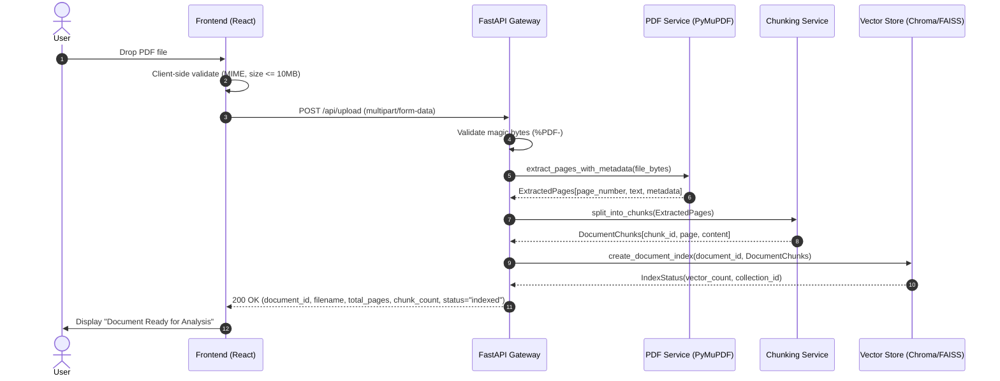
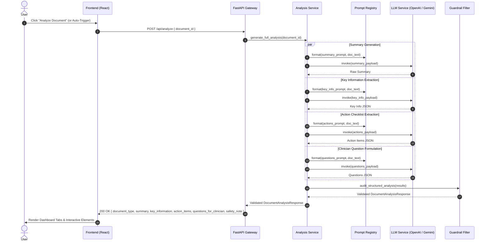
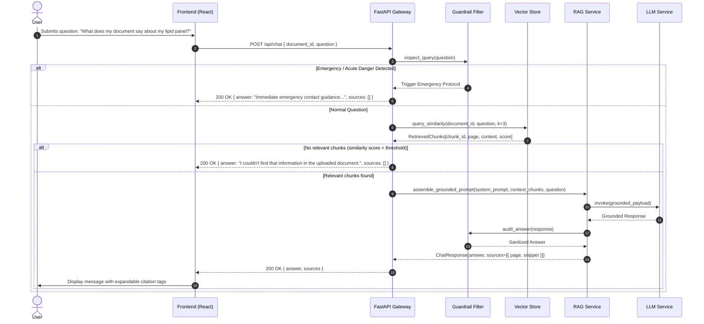

# CareBridge AI — System Architecture Specification

## 1. System Overview & Architectural Paradigm

CareBridge AI follows a modular, decoupled, multi-tier architecture designed for deterministic document intelligence, source-grounded retrieval-augmented generation (RAG), and strict healthcare safety guardrails.

```mermaid
graph TD
    subgraph Client Tier [Client Tier - Single Page App]
        UI[React 18 + Vite + Tailwind CSS]
        State[Document & Chat Context Store]
        APIClient[Axios API Gateway Client]
        UI --> State
        State --> APIClient
    end

    subgraph Gateway Tier [FastAPI Application Gateway]
        CORS[CORS Middleware & Security Headers]
        Router[API Route Controllers]
        Validation[Pydantic v2 Request/Response Validation]
        CORS --> Router --> Validation
    end

    subgraph Service Tier [Core Services & Logic Layer]
        PDFSvc[PDF Extraction Service - PyMuPDF]
        ChunkSvc[Chunking & Normalization Service]
        EmbedSvc[Embedding Service - OpenAI / Fallback]
        VectorSvc[Vector Store Service - ChromaDB / FAISS]
        RAGSvc[RAG Retrieval & Citation Service]
        PromptSvc[Modular Prompt Registry]
        LLMSvc[LLM Orchestration Service]
        AnalysisSvc[Structured Document Analysis Service]
    end

    subgraph Safety Tier [Healthcare Guardrail Layer]
        InputSafety[Clinical Keyword & Emergency Triage]
        PromptGuard[System Prompt Enforcement Layer]
        OutputSafety[Hallucination & Advice Filter]
    end

    subgraph Storage Tier [Transient Session Storage]
        DocStore[Temporary Ingestion Buffer]
        VectorStore[In-Memory / Local Vector Index]
    end

    APIClient <==> |HTTPS / REST JSON| Gateway Tier
    Validation --> Service Tier
    PDFSvc --> ChunkSvc --> EmbedSvc --> VectorSvc
    VectorSvc --> VectorStore
    PDFSvc --> DocStore
    RAGSvc --> VectorSvc
    RAGSvc --> PromptSvc
    RAGSvc --> SafetyTier
    LLMSvc --> SafetyTier
    AnalysisSvc --> PromptSvc
    AnalysisSvc --> LLMSvc
    AnalysisSvc --> SafetyTier
```

---

## 2. Component Decomposition & Responsibilities

### 2.1 Frontend Tier (`frontend/`)
- **Technology:** React 18, Vite, TypeScript, Tailwind CSS, Lucide React.
- **Responsibilities:**
  - Client-side validation: MIME type check (`application/pdf`), file size constraints ($\le 10\text{ MB}$), empty file detection.
  - Interactive upload dropzone with upload progress indication.
  - Real-time processing telemetry (displaying stepper: parsing $\rightarrow$ chunking $\rightarrow$ indexing $\rightarrow$ analyzing).
  - Executive summary presentation with clear category cards.
  - Key information extraction table with copyable fields and unit values.
  - Interactive action checklist with local state management (mark completed/pending).
  - Healthcare professional question generator with one-click export/copy.
  - Conversational RAG chat with expandable source badges (page number, text snippet preview).
  - Global, persistent safety disclaimers and emergency boundary banners.

### 2.2 Backend Gateway Tier (`backend/app/api/`)
- **Technology:** Python 3.11+, FastAPI, Uvicorn, Pydantic v2.
- **Responsibilities:**
  - Route handlers: `/api/upload`, `/api/analyze`, `/api/chat`, `/api/health`, `/api/samples`.
  - Content-Type enforcement (`multipart/form-data` for uploads, `application/json` for chat/analysis).
  - Cross-Origin Resource Sharing (CORS) restricted to authorized origins.
  - Standardized error handling returning structured JSON envelopes (`{ "error": true, "code": "...", "message": "..." }`).

### 2.3 Document Processing Layer (`backend/app/services/pdf_service.py`, `chunking_service.py`)
- **Technology:** PyMuPDF (`fitz`), LangChain Text Splitters.
- **Responsibilities:**
  - High-performance binary stream parsing.
  - Header, footer, page number stripping and whitespace normalization.
  - Page-tagged chunking: Every chunk maintains `{ "document_id": "...", "page": int, "chunk_id": int, "total_pages": int }`.
  - Splitting parameters: Target chunk size = 600 characters / ~150 tokens, overlap = 100 characters to preserve cross-boundary medical phrases.

### 2.4 Vector & Retrieval Layer (`backend/app/services/vector_store_service.py`, `rag_service.py`)
- **Technology:** ChromaDB (primary) / FAISS (in-memory fallback), OpenAI / HuggingFace Embeddings.
- **Responsibilities:**
  - Per-document vector collection isolation (`collection_name = f"doc_{document_id}"`).
  - Cosine distance similarity search ($k = 3$ to $4$).
  - Minimum similarity threshold filtering to prevent irrelevant chunk injection.
  - Source snippet and metadata extraction for citation construction.

### 2.5 Prompt Engineering & LLM Layer (`backend/app/prompts/`, `llm_service.py`, `analysis_service.py`)
- **Technology:** LangChain Core, ChatOpenAI / ChatGoogleGenerativeAI / Deterministic Offline Mock LLM.
- **Responsibilities:**
  - Decoupled prompt templates:
    1. `system_prompt.py`: Core safety guardrails, tone, persona, medical disclaimers.
    2. `summary_prompt.py`: Executive patient summary generation.
    3. `key_information_prompt.py`: Structured extraction of tests, values, dates, providers.
    4. `action_items_prompt.py`: Extraction of explicit clinician instructions.
    5. `doctor_questions_prompt.py`: Derivation of consultation questions.
    6. `rag_prompt.py`: Grounded question answering strictly over context.
  - Structured output parsing using Pydantic schemas.

---

## 3. End-to-End Sequence & Data Flow

### 3.1 Ingestion & Processing Flow (`/api/upload`)



### 3.2 Document Analysis Flow (`/api/analyze`)



### 3.3 RAG Question Answering Flow (`/api/chat`)



---

## 4. Complete Data Contracts (Schemas)

### 4.1 `/api/upload` (POST)
- **Request:** `multipart/form-data` containing `file: UploadFile`.
- **Response Model:** `DocumentUploadResponse`
```json
{
  "document_id": "3fa85f64-5717-4562-b3fc-2c963f66afa6",
  "filename": "Comprehensive_Metabolic_Panel.pdf",
  "file_size_bytes": 142850,
  "total_pages": 3,
  "total_chunks": 14,
  "status": "indexed",
  "message": "Document successfully extracted and indexed into knowledge base."
}
```

### 4.2 `/api/analyze` (POST)
- **Request Model:** `DocumentAnalysisRequest`
```json
{
  "document_id": "3fa85f64-5717-4562-b3fc-2c963f66afa6"
}
```
- **Response Model:** `DocumentAnalysisResponse`
```json
{
  "document_id": "3fa85f64-5717-4562-b3fc-2c963f66afa6",
  "document_type": "Laboratory Blood Chemistry Report",
  "summary": "This document contains routine outpatient blood chemistry results for John Doe dated October 14, 2026. The panel includes renal function, electrolyte balances, and liver enzyme measurements.",
  "key_information": [
    {
      "category": "Patient & Date",
      "label": "Document Date",
      "value": "October 14, 2026",
      "source_page": 1
    },
    {
      "category": "Test Findings",
      "label": "Glucose (Fasting)",
      "value": "104 mg/dL (Reference: 70-99 mg/dL)",
      "source_page": 1
    },
    {
      "category": "Test Findings",
      "label": "Serum Creatinine",
      "value": "0.9 mg/dL (Reference: 0.6-1.3 mg/dL)",
      "source_page": 2
    }
  ],
  "action_items": [
    {
      "id": "act_1",
      "description": "Schedule routine 3-month fasting glucose re-check as noted on page 2.",
      "completed": false,
      "source_page": 2
    },
    {
      "id": "act_2",
      "description": "Maintain hydration and continue current diet as advised in clinician notes.",
      "completed": false,
      "source_page": 3
    }
  ],
  "questions_for_clinician": [
    "My fasting glucose was slightly above standard reference limits (104 mg/dL). Does this warrant dietary adjustments or follow-up testing?",
    "Are there any specific lifestyle modifications recommended prior to our next evaluation?",
    "When should I repeat this comprehensive metabolic panel?"
  ],
  "safety_note": "CareBridge AI provides educational summaries and does not provide clinical diagnoses or treatment plans. Discuss these laboratory values with your ordering physician."
}
```

### 4.3 `/api/chat` (POST)
- **Request Model:** `DocumentChatRequest`
```json
{
  "document_id": "3fa85f64-5717-4562-b3fc-2c963f66afa6",
  "question": "What instructions were given regarding my medications?"
}
```
- **Response Model:** `DocumentChatResponse`
```json
{
  "document_id": "3fa85f64-5717-4562-b3fc-2c963f66afa6",
  "question": "What instructions were given regarding my medications?",
  "answer": "According to page 3 of the document, you were instructed to continue your current morning multivitamin and resume your routine blood pressure medication at your prescribed dosage. No medication changes or cancellations were documented.",
  "sources": [
    {
      "page": 3,
      "chunk_id": 9,
      "snippet": "Medication Reconciliation: Patient to resume routine Lisinopril 10mg daily as previously prescribed. No acute medication changes indicated at this visit."
    }
  ],
  "is_grounded": true
}
```

---

## 5. Error Handling & Resilience Matrix

| Error Scenario | Root Cause | System Response & Code | User-Facing Action |
| :--- | :--- | :--- | :--- |
| **Invalid MIME Type** | User selected `.docx`, `.png`, or `.exe` | `415 Unsupported Media Type` | "Only PDF documents are supported. Please select a valid `.pdf` file." |
| **Corrupt PDF / Header Missing** | File lacks `%PDF-` signature or EOF marker | `400 Bad Request` | "Unable to read this file. It may be corrupt or encrypted. Please try a different PDF." |
| **Password-Protected PDF** | File requires encryption key | `422 Unprocessable Entity` | "This document is password-protected. Please upload an unencrypted copy." |
| **Empty Document** | PDF contains zero readable text pages | `422 Unprocessable Entity` | "No readable text found. If this is a photo scan, please upload a text-readable PDF." |
| **LLM Provider Outage / Missing Key** | API key not set or provider rate limited | `503 Service Unavailable` with graceful mock fallback | "AI service is currently operating in offline demonstration mode. Test analysis loaded." |
| **Out-of-Scope RAG Query** | Question asks for facts not in document | `200 OK` with `is_grounded: false` | "I couldn't find that information in the uploaded document. Please discuss this with your doctor." |

---

## 6. Architecture Verification & Readiness

This architectural specification establishes:
1. Strict boundaries between frontend presentation, backend routing, vector storage, and LLM reasoning.
2. Complete schema definitions preventing runtime shape mismatches.
3. Healthcare safety protocols embedded at the ingress and egress of every LLM interaction.
4. Deterministic fallbacks to guarantee a functional demonstration under any network or credential condition.
